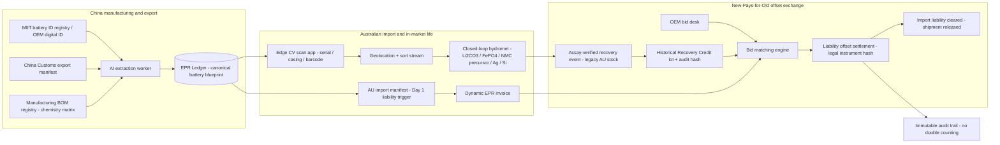

# EPR Capture & Material Offset Exchange (CN → AU)

**A working mock-up of a cross-border system where new battery and solar imports into Australia pay a Day-1 levy, and importers clear part of that levy by funding the recovery of old stock already in the country — earning first dibs on the materials that recovery produces.**

Built as an interactive explainer + reference implementation: architecture diagram, liability calculator, offset exchange, and the database schema that makes the legal offset auditable.

---

## The idea in 60 seconds

Australia already carries **~200,000 tonnes of end-of-life batteries** and **~280,000 tonnes of legacy solar panels** in-market. That stock is *orphan waste* — no producer left to bill, and no funded recovery infrastructure to process it. Meanwhile, the (largely Chinese) manufacturers shipping new product into Australia are structurally short of secure feedstock: lithium, nickel, cobalt, silver, silicon.

This architecture is the bridge between those two facts:

1. **New import lands** → a Day-1 EPR invoice is issued to the importer, priced per kilogram by chemistry.
2. **Legacy stock is recovered** → old stock is scanned, sorted and hydromet-processed into battery-grade materials; verified output mints a **credit lot**.
3. **OEMs bid for credits** → credits offset the invoice *and* carry first-refusal off-take rights on the recovered Li₂CO₃, NiSO₄, CoSO₄, FePO₄, silver and silicon.
4. **Australia builds capacity** → settlement is hash-linked (no double counting); credit revenue is ring-fenced to fund the collection and processing infrastructure the country lacks.

New importers aren't *taxed* for someone else's historical waste — they *voluntarily pre-purchase* verified recovery output at a discount to material value, and the regulator recognises that purchase as partial liability discharge. The mandatory levy funds the standing collection network; the voluntary credit market funds legacy drawdown and the processing plant. Two instruments, two legal bases, one ledger.

## The numbers (October 2026 prices)

| Stream | Proposed levy | Rationale |
|---|---|---|
| EV / ESS batteries | **A$4–7 /kg** (≈ A$1,300–2,200 per EV pack, ~3% of sticker) | Covers collection + sorting; processing part-funded by material value |
| Solar PV | **A$5–8 /panel** | Legacy 2009–15 panels hold ~A$73 of recoverable value each (silver at ~US$58/oz is ~3× the price older studies assumed) |
| 3C handheld (phones, laptops, tradie packs) | **A$5 /kg** | A$0.25 on a phone → A$17.50 on an e-bike; funds the costliest collection stream |

**Battery-grade recovered value per tonne of whole pack (hydromet output, current spot):**

| Output | NMC 811 pack | LFP pack | LCO phone/laptop |
|---|---:|---:|---:|
| Li₂CO₃ | A$2,240 | A$1,380 | A$3,150 |
| Ni as NiSO₄ | A$3,410 | — | — |
| Co as CoSO₄ | A$950 | — | A$13,260 |
| Mn as MnSO₄ | A$45 | — | — |
| FePO₄ precursor | — | A$560 | — |
| Cu/Al foils & frame | A$940 | A$940 | A$940 |
| **Gross value / tonne** | **~A$7,570** | **~A$2,880** | **~A$17,350** |

Two things worth noticing:

- **Lithium is only 18–48% of recovered value** depending on chemistry — so credits should be denominated in basket value at assay, not kilograms of lithium.
- **LFP only pencils out if you recover FePO₄ to battery grade.** Selling black mass loses money on LFP; regenerating cathode precursor doesn't. That capability is what makes LFP credit lots biddable.

## Architecture



**Three layers:**

1. **Upstream AI capture (EPR Ledger)** — China Customs manifests, MIIT battery-ID registry fields and factory BOM data are normalised into one battery blueprint per shipment; the Day-1 invoice is computed from weight × chemistry matrix × product category.
2. **In-market edge traceability** — a mobile/industrial app scans casing, serial or barcode, resolves the OEM blueprint, logs geolocation and pre-sorts before transport.
3. **Offset exchange** — verified legacy recovery becomes a tradable credit lot; importer bids clear new-import liabilities against a single, hash-linked settlement record.

## What's in this repo

| Path | What it is |
|---|---|
| `contracts/epr.ts` | The mock liability engine (shared by frontend and API): chemistry matrices, levy rates, invoice calculation, sample credit lots and bids |
| `api/eprRouter.ts` | tRPC endpoint wrapping the engine |
| `db/schema.ts` | Conceptual schema: OEM → blueprint → manifest → liability → edge scan → recovery event → credit bid → **legal offset** |
| `src/components/LiabilitySimulator.tsx` | Interactive Day-1 invoice calculator |
| `src/components/OffsetExchange.tsx` | Scan-to-sort stream + bidding preference engine |
| `src/components/CodeWorkbench.tsx` | Downloadable artefacts: Mermaid DFD, Python mock, SQL schema |
| `src/data/artifacts.ts` | The Mermaid / Python / SQL source text |

Run it:

```bash
npm install   # regenerates package-lock.json
npm run dev   # http://localhost:3000
```

Production: `npm run build && npm start` (or use the included `Dockerfile`).

## Caveats

- **All rates are illustrative.** Swap in the approved Australian fee schedule at deployment; credit prices should be index-linked to spot (lithium moved ~70% inside six months of 2026).
- The chemistry matrices in `contracts/epr.ts` are cathode-active-material fractions; per-tonne pack economics assume ~27% cathode share for packs and ~38% for small-format cells.
- This is a conceptual architecture mock, not legal, regulatory or investment advice.

---

*Accelerating industrial decarbonisation — [@CetaceaCircular](https://github.com/CetaceaCircular)*
